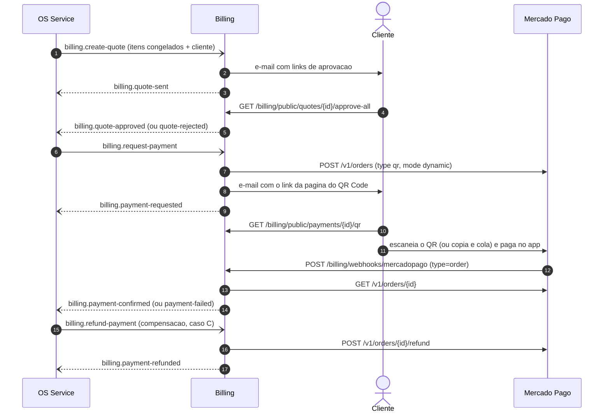
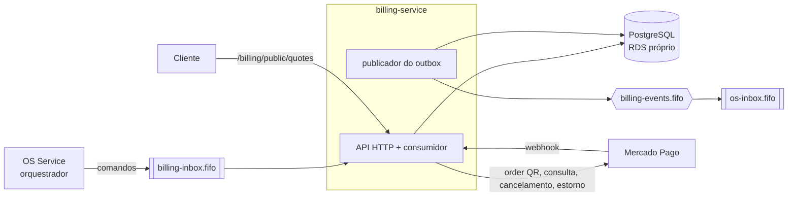

# oficina-mecanica-billing-service

Orçamento, decisão do cliente e cobrança das ordens de serviço da oficina
mecânica. Participante da Saga orquestrada pelo
[OS Service](https://github.com/SOAT-15-Oficina/oficina-mecanica-os-service).

A arquitetura do sistema completo, as RFCs e as ADRs vivem no
[oficina-mecanica-infrastructure](https://github.com/SOAT-15-Oficina/oficina-mecanica-infrastructure/tree/main/docs),
em especial a [RFC-0006](https://github.com/SOAT-15-Oficina/oficina-mecanica-infrastructure/blob/main/docs/rfc/0006-microsservicos-e-saga.md).

## Responsabilidade

| Faz | Não faz |
|---|---|
| gera e envia o orçamento a partir dos itens congelados recebidos da OS | decide o que entra na OS |
| registra a decisão do cliente, item a item, pelos links públicos | altera o status da OS (só publica eventos) |
| cobra por QR Code dinâmico do Mercado Pago (Orders API) e confirma por consulta à API | lê o banco de outro serviço |
| estorna quando a Saga compensa | |

## Fluxo

O Billing so reage a comandos do OS Service (fila `billing-inbox.fifo`) e a
dois atores externos: o cliente, pelos links do e-mail, e o Mercado Pago,
pelo webhook. Tudo o que ele tem a dizer sai como evento no topico
`billing-events.fifo`, que o OS Service assina.



### Mensagens

| Recebe | Efeito | Responde |
|---|---|---|
| `billing.create-quote` | grava `quotes` e `quote_items` (um orçamento por OS; repetição devolve o mesmo) e envia o e-mail | `billing.quote-sent` |
| `billing.request-payment` | cria a order QR no Mercado Pago (`expiration_time` = `PAYMENT_EXPIRATION` em ISO 8601), grava o pagamento `PENDENTE` com o `qr_data` e envia por e-mail o link da página do QR; um pagamento pendente ainda válido é reaproveitado | `billing.payment-requested` (`checkout_url` = página do QR) |
| `billing.refund-payment` | estorna a order do pagamento `APROVADO` (chave de idempotência = `message_id`) e marca `ESTORNADO` | `billing.payment-refunded` (campos vazios quando não há pagamento aprovado) |
| `billing.cancel-quote` | cancela no Mercado Pago a order de cada pagamento `PENDENTE`, depois orçamento `CANCELADO` e pagamentos `PENDENTE` viram `EXPIRADO` | `billing.quote-canceled` (sem `quote_id` quando não há orçamento) |
| qualquer outro tipo | marcado como processado e logado (`billing.message_ignored`) | — |

| Origem | Evento publicado |
|---|---|
| cliente decide o último item pendente, com ao menos um aprovado | `billing.quote-approved` (itens aprovados, reprovados e total aprovado) |
| cliente decide o último item pendente, todos reprovados | `billing.quote-rejected` (`CLIENTE`) |
| webhook com order `processed` | `billing.payment-confirmed` (`provider_payment_id` = id `PAY...` da transação) |
| webhook com order `expired` | `billing.payment-failed` (`EXPIRADO`) |
| webhook com order `canceled` que o Billing não pediu (pagamento ainda `PENDENTE`) | `billing.payment-failed` (`RECUSADO`) |
| webhook com order `refunded` | nenhum; só garante o pagamento `ESTORNADO` |

`billing.request-payment` para um orçamento inexistente ou não aprovado
responde `billing.payment-failed` (`RECUSADO`, `payment_id` nulo) para a Saga
compensar em vez de esperar o prazo.

### Garantias

- **Uma transação por mensagem**: `pgoutbox.MarkProcessed`, o efeito e o
  `pgoutbox.Enqueue` da resposta são gravados juntos; o relay do outbox
  publica depois. Nenhum handler publica direto.
- **Chamadas externas fora da transação**: criação, cancelamento e estorno da
  order no Mercado Pago acontecem antes da transação, depois de uma checagem
  em `processed_messages`, sempre com `X-Idempotency-Key` derivada do
  `message_id`. Se a transação falhar, a mensagem volta para a fila e a
  chamada é repetida com a mesma chave; o id do pagamento também é derivado
  do `message_id` (UUID v5), então a order repetida continua apontando para
  ele pelo `external_reference`.
- **E-mail depois do commit**: falha de envio é só logada
  (`billing.email_failed`), como no monólito; o cliente continua tendo o
  resumo em `/billing/public/quotes/{id}`.
- **Webhook não é fonte da verdade**: a assinatura é validada, o corpo é
  ignorado e o status vem de `GET /v1/orders/{id}`. O pagamento é achado
  pelo `provider_order_id` e só sai de `PENDENTE` uma vez, então notificação
  repetida ou fora de ordem não gera evento novo.
- **Processo único**: API, consumidor da `billing-inbox` e relay do outbox
  são goroutines do mesmo processo e param juntos no `SIGTERM`.

## Endpoints

Vistos pelo cliente com o prefixo `/api` (o gateway remove).

| Método e rota | Auth | Função |
|---|---|---|
| `GET /billing/quotes/by-work-order/{workOrderId}` | JWT `admin` ou `employee` | orçamento, itens, decisões e pagamentos (com `provider_order_id`, `qr_code_url` e `qr_data`) |
| `GET /billing/public/quotes/{quoteId}` | público | resumo para o cliente, com `payments` (`provider_order_id`, `qr_code_url`, `qr_data`) e `payment_url` enquanto houver pagamento pendente |
| `GET /billing/public/payments/{paymentId}/qr` | público | página do QR Code (PNG embutido, copia e cola, valor, validade e situação); fora de `PENDENTE` mostra só a situação |
| `GET /billing/public/payments/{paymentId}/qr.png` | público | imagem do QR Code |
| `GET /billing/public/quotes/{quoteId}/items/{workOrderServiceId}/approve` | público | aprova um item |
| `GET /billing/public/quotes/{quoteId}/items/{workOrderServiceId}/reject` | público | reprova um item |
| `GET /billing/public/quotes/{quoteId}/approve-all` | público | aprova todos os pendentes |
| `GET /billing/public/quotes/{quoteId}/reject-all` | público | reprova todos os pendentes |
| `POST /billing/webhooks/mercadopago?data.id=&type=order` | `x-signature` | notificação de order do Mercado Pago |
| `GET /ping`, `GET /ready` | público | liveness e readiness |
| `GET /billing/swagger`, `GET /billing/docs/swagger.yaml` | público | contrato |

Decidir um item já decidido, ou qualquer item de orçamento aprovado,
reprovado ou cancelado, responde **409**. Assinatura inválida no webhook
responde **401**; falha ao consultar o Mercado Pago responde **500** para ele
reenviar.

A assinatura segue o Mercado Pago: `x-signature: ts=<ts>,v1=<hex>`, onde `v1`
é o HMAC-SHA256, com `MERCADOPAGO_WEBHOOK_SECRET`, do manifesto
`id:<data.id>;request-id:<x-request-id>;ts:<ts>;`. A documentação manda usar o
id em minúsculas para ids alfanuméricos; o Billing aceita a assinatura com o
id em minúsculas ou como veio, e omite o trecho `request-id:...;` quando o
header `x-request-id` não vem.

## Arquitetura do serviço



| Peça | Tecnologia |
|---|---|
| Linguagem / HTTP | Go 1.26, Fiber v3 |
| Banco | PostgreSQL 17 (RDS), migrations com goose |
| Mensageria | SQS FIFO (entrada), SNS FIFO (saída), outbox transacional |
| Pagamento | Mercado Pago, QR Code dinâmico pela Orders API (ambiente de testes) |
| Observabilidade | slog JSON + Datadog APM |
| Deploy | EKS via kustomize, Terraform próprio em `infra/` |

### Modelo de dados

| Tabela | Conteúdo |
|---|---|
| `quotes` | um orçamento por OS, com cópia de nome e e-mail do cliente |
| `quote_items` | itens congelados e decisão do cliente por item |
| `payments` | order QR (`provider_order_id`, `qr_data`) e transação (`provider_payment_id`, id `PAY...`) no Mercado Pago; no máximo um aprovado por orçamento |
| `outbox` | eventos a publicar, gravados na mesma transação do efeito |
| `processed_messages` | `message_id` já processados, para idempotência |

## Pagamento por QR Code

A aplicação do Mercado Pago é de **QR Code (pagamentos presenciais)**, então o
Billing usa a **Orders API**
com QR dinâmico, e não o Checkout Pro:

1. `billing.request-payment` faz `POST /v1/orders` com `type: qr`,
   `config.qr.mode: dynamic`, `config.qr.external_pos_id` =
   `MERCADOPAGO_POS_EXTERNAL_ID`, `external_reference` = id do pagamento,
   `expiration_time` em ISO 8601, os itens aprovados (valores em string com
   duas casas) e `X-Idempotency-Key` = `message_id`. A resposta traz o id da
   order (`ORD...`) e `type_response.qr_data`, o código EMV do QR.
2. O pagamento é gravado `PENDENTE` com o `qr_data`. O `checkout_url` de
   `billing.payment-requested` e o link do e-mail apontam para
   `{APP_BASE_URL}/billing/public/payments/{paymentId}/qr`, página que gera o
   PNG a partir do `qr_data` e mostra também o "copia e cola".
3. O cliente paga no app; o Mercado Pago chama o webhook e o Billing decide
   pelo status de `GET /v1/orders/{id}` (tabela em [Mensagens](#mensagens)).
   Não existe "recusado" em order QR: um cartão recusado no app não muda a
   order, que expira.
4. Compensação: `billing.cancel-quote` com pagamento pendente faz
   `POST /v1/orders/{id}/cancel` (409, order que já não está `created`, conta
   como cancelada); `billing.refund-payment` faz `POST /v1/orders/{id}/refund`
   e, se a rota responder 404 ou 405, tenta `/refunds` (a referência e o guia
   divergem). 409 `order_already_refunded` conta como sucesso.

### Configurando uma conta nova do Mercado Pago

As orders QR precisam de uma loja e de um caixa na conta dona do token. O
subcomando `mp-setup` cria os dois de forma idempotente: lê o usuário em
`GET /users/me`, procura a loja por `external_id` (`OFICINAMATRIZ`) e o caixa
por `MERCADOPAGO_POS_EXTERNAL_ID`, e só cria o que não existir
(`POST /users/{id}/stores` e `POST /v2/pos` com
`config.qr.operating_mode: pdv`). Rodar de novo não duplica nada.

```bash
MERCADOPAGO_ACCESS_TOKEN=TEST-... go run ./cmd/api mp-setup
# ou, com a imagem publicada:
docker run --rm -e MERCADOPAGO_ACCESS_TOKEN=TEST-... <imagem-do-billing> mp-setup
```

O log `mercado pago store and pos ready` mostra os ids e se cada um foi criado
agora. Na conta de teste atual a loja (`83215069`) e o caixa (`140866185`) já
existem.

Depois, no [painel de desenvolvedores](https://www.mercadopago.com.br/developers/panel/app),
em **Webhooks > Configurar notificações** da aplicação:

1. URL de produção (e de teste): `https://<host>/api/billing/webhooks/mercadopago`.
2. Evento: **Order (Mercado Pago)**. Não existe `notification_url` na order;
   sem esse evento marcado o webhook nunca chega.
3. Copie a **assinatura secreta** gerada para `MERCADOPAGO_WEBHOOK_SECRET`.

O Mercado Pago espera 200 em até 22 s e reenvia a cada 15 min; falha ao
consultar a order responde 500 justamente para ele reenviar.

## Configuração

| Variável | Padrão | Uso |
|---|---|---|
| `SERVER_PORT`, `SERVER_ENVIRONMENT` | `8080` | HTTP e ambiente |
| `APP_BASE_URL` | — | URL pública com `/api`; base dos links do e-mail |
| `JWT_SECRET_KEY` | — | mesmo segredo HS256 da Lambda de autenticação |
| `DATABASE_*` | — | PostgreSQL próprio |
| `AWS_DEFAULT_REGION`, `AWS_ENDPOINT_URL` | `sa-east-1` | SQS/SNS/SES; endpoint só no LocalStack |
| `MESSAGING_INBOX_QUEUE_URL` | — | `billing-inbox.fifo`; vazio desliga o consumidor |
| `MESSAGING_EVENTS_TOPIC_ARN` | — | `billing-events.fifo` |
| `MESSAGING_POLL_WAIT` | `20s` | long polling do consumidor |
| `OUTBOX_POLL_INTERVAL` | `500ms` | intervalo do relay do outbox |
| `MERCADOPAGO_BASE_URL` | `https://api.mercadopago.com` | API real ou o fake |
| `MERCADOPAGO_ACCESS_TOKEN`, `MERCADOPAGO_WEBHOOK_SECRET` | — | segredos |
| `MERCADOPAGO_POS_EXTERNAL_ID` | `OFICINAMATRIZPOS01` | `external_pos_id` do caixa onde as orders QR são criadas |
| `PAYMENT_EXPIRATION` | `48h` | validade do QR, enviada como `expiration_time` ISO 8601 (`PT48H`); o Mercado Pago aceita de 30s a 3600h |
| `EMAIL_PROVIDER` | `mailhog` | `mailhog` ou `ses` |
| `EMAIL_HOST`, `EMAIL_PORT`, `EMAIL_FROM` | `localhost`, `1025` | mailhog |
| `SES_SENDER_EMAIL`, `SES_REPLY_TO`, `SES_CONFIG_SET` | — | SES (credenciais pelo IRSA) |

Se o provedor de e-mail não puder ser criado, o serviço sobe sem e-mail e loga
o erro, em vez de entrar em crashloop.

## Como rodar

```bash
cp .env.example .env
docker compose up --build
curl localhost:8091/ping
```

O compose sobe API (8091), PostgreSQL (5433), LocalStack (4566, filas e
tópico criados por `local/localstack/init.sh`), mailhog (8025) e o fake do
Mercado Pago (8095). As portas do host podem ser trocadas por
`API_HOST_PORT`, `DB_HOST_PORT`, `LOCALSTACK_HOST_PORT`, `MAILHOG_HOST_PORT` e
`MPFAKE_HOST_PORT`.

### Testando o pagamento com o fake do Mercado Pago

`cmd/mpfake` é um Mercado Pago em memória (`docker build --target mpfake`)
que simula a Orders API:

| Rota | Comportamento |
|---|---|
| `POST /v1/orders` | exige bearer, `X-Idempotency-Key`, `type: qr`, `mode: dynamic` e o `external_pos_id` configurado; devolve id `ORDTST` + 26 caracteres e `type_response.qr_data` EMV; mesma chave devolve a mesma order |
| `GET /v1/orders/{id}` | a order com status e transação |
| `POST /v1/orders/{id}/cancel` | `created` vira `canceled`; outro status responde 409 |
| `POST /v1/orders/{id}/refund` | `processed` vira `refunded`; repetido responde 409 `order_already_refunded` |
| `GET /users/me`, `GET/POST /users/{id}/stores...`, `GET /pos`, `POST /v2/pos` | o que o `mp-setup` usa |
| `POST /__orders/{id}/pay` | order `processed` e webhook `order.processed` |
| `POST /__orders/{id}/expire` | order `expired` e webhook `order.expired` |
| `GET /__orders/{id}` | página com os botões **Pagar** e **Expirar** |
| `GET /__health` | healthcheck |

O webhook vai para `MPFAKE_WEBHOOK_URL` (`?data.id=<ORD...>&type=order`),
assinado com `MERCADOPAGO_WEBHOOK_SECRET` sobre o manifesto com o id em
minúsculas, como o Mercado Pago real. O caixa aceito vem de
`MERCADOPAGO_POS_EXTERNAL_ID` (padrão `OFICINAMATRIZPOS01`).

1. Publique um `billing.create-quote` na fila (no compose do
   `-infrastructure` quem faz isso é o OS Service):

   ```bash
   WO=$(uuidgen); ITEM=$(uuidgen)
   docker compose exec localstack awslocal sqs send-message \
     --queue-url http://localhost:4566/000000000000/billing-inbox.fifo \
     --message-group-id "$WO" --message-deduplication-id "$(uuidgen)" \
     --message-body '{"message_id":"'"$(uuidgen)"'","type":"billing.create-quote","version":1,
       "saga_id":"'"$(uuidgen)"'","work_order_id":"'"$WO"'","correlation_id":"local",
       "occurred_at":"2026-11-11T10:00:00Z","payload":{"work_order_code":"OS-1",
       "customer":{"name":"Maria","email":"maria@example.com"},
       "items":[{"work_order_service_id":"'"$ITEM"'","title":"Troca de oleo","price_cents":15000,"estimated_time_minutes":30}]}}'
   ```

2. Abra o e-mail em <http://localhost:8025> e clique em **Aprovar todos**.
3. Publique `billing.request-payment` com o mesmo `work_order_id` e payload
   `{"quote_id":"<id do orcamento>"}`. O link da página do QR chega por e-mail;
   o id da order aparece em `GET /billing/public/quotes/{quoteId}`
   (`payments[].provider_order_id`).
4. Abra `http://localhost:8095/__orders/<provider_order_id>` e clique em
   **Pagar** ou **Expirar** (ou faça `POST` nas rotas `/__orders/{id}/pay` e
   `/expire`). O fake chama o webhook, o Billing consulta a order e publica
   `billing.payment-confirmed` ou `billing.payment-failed` (`EXPIRADO`).

Para ver os eventos, assine uma fila FIFO no tópico `billing-events.fifo` com
`RawMessageDelivery=true`.

## Testes e cobertura

```bash
go test ./... -coverprofile=coverage.out
./scripts/coverage-gate.sh coverage.out
```

O CI reprova abaixo de **80%** duas vezes: no job `test`, pelo
`scripts/coverage-gate.sh`, e no job `quality`, pelo Quality Gate
`oficina-fase4` do SonarQube (cobertura, bugs, vulnerabilidades e duplicação).
`cmd/`, `database/` e `docs/` ficam fora da métrica: são wiring e arquivos
embutidos.

Os testes de `internal/billing`, `internal/database` e `pgoutbox` usam
PostgreSQL de verdade e são pulados sem `DATABASE_HOST` (no CI, um service
container). Mercado Pago, e-mail e SQS/SNS são substituídos por fakes; o
cliente do Mercado Pago é testado contra `httptest.Server` e o fake, de ponta
a ponta, com o próprio cliente.

| Pacote | Cobertura |
|---|---|
| `internal/auth` | 91,7% |
| `internal/billing` | 89,7% |
| `internal/config` | 100% |
| `internal/database` | 89,2% |
| `internal/mercadopago` | 99,5% |
| `internal/messaging` | 95,6% |
| `internal/messaging/pgoutbox` | 88,6% |
| `internal/mpfake` | 100% |
| `internal/observability` | 85,7% |
| `internal/routes` | 98,9% |
| `internal/routes/middlewares` | 96,0% |
| `packages/email` | 98,8% |
| **total (métrica do gate)** | **95,3%** |

## Pipeline

| Evento | Jobs |
|---|---|
| PR para `main` ou `hml` | `lint` (actionlint, redocly, terraform validate, kubeconform), `test` (cobertura ≥ 80%), `quality` (SonarQube) |
| push em `hml` | deploy em homologação |
| push em `main` | deploy em produção |

O deploy aplica `infra/`, publica a imagem no ECR, sincroniza o segredo do
Secrets Manager para o cluster, aplica `k8s/overlays/<ambiente>`, roda as
migrations num Job e confere `/ping` e o contrato servido.

## Contrato

- HTTP: [`docs/swagger.yaml`](docs/swagger.yaml), servido em `/api/billing/swagger`.
- Mensagens: `internal/messaging/catalog.go` (idêntico nos três serviços) e
  catálogo na RFC-0006, seção 5.
- JWT: `internal/auth/testdata/token.golden` é o mesmo fixture dos outros
  repositórios.
